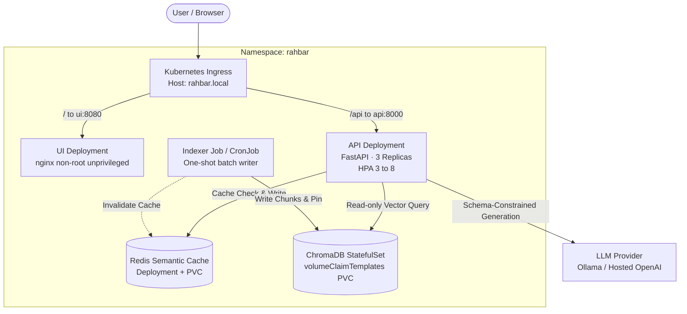

# RAHBAR: Grounded Question-Answering Service on Kubernetes

[](https://github.com/Adnan3974/rahbar/actions/workflows/ci.yml)
[](LICENSE)
[](https://kubernetes.io)
[](https://python.org)

RAHBAR is an enterprise-grade, grounded question-answering system operating over authoritative academic policy documents and institutional reports from FAST-NUCES. Built to eliminate large language model hallucination, RAHBAR enforces strict schema validation, structural chunking with boundary overlap, query-time metadata filtering for policy versioning, honest abstention mechanisms, and sub-millisecond semantic caching. The entire platform is deployed as a resilient, horizontally scalable cloud-native topology on Kubernetes.

---

## Architecture Overview

RAHBAR separates indexing and querying into strictly decoupled operational paths following the **One Writer, Many Readers** paradigm.



---

## API Specification

| Method | Endpoint | Description | Request Payload | Response Contract |
|---|---|---|---|---|
| GET | /healthz | Liveness probe: verifies process is alive (zero dependency coupling) | None | {"status": "alive"} |
| GET | /readyz | Readiness probe: verifies Chroma, collection > 0, Redis, and model pin | None | {"status": "ready", "checks": {...}} |
| GET | /metrics | Prometheus metrics endpoint for monitoring and custom HPA scaling | None | Prometheus text format |
| POST | /api/ask | Main question-answering endpoint with schema-validated output | {"question": "..."} | AskResponse JSON with citations and retrieved passages |

---

## Getting Started

### 1. Prerequisites
- Python 3.12+
- Docker & Minikube (with Calico CNI)
- `kubectl` and `kustomize`
- Ollama running locally (for `ollama-host` mode):
  ```bash
  OLLAMA_HOST=0.0.0.0 ollama serve
  ollama pull llama3.2:3b
  ollama pull nomic-embed-text
  ```

### 2. Cluster Initialization
Start Minikube with the Calico network plugin to enforce Kubernetes `NetworkPolicy` manifests:
```bash
minikube start --driver=docker --cni=calico --memory=6144 --cpus=4
minikube addons enable metrics-server
minikube addons enable ingress
```

### 3. Build and Load Images
Build local container images and load them into Minikube's image cache:
```bash
make images
```

### 4. Kubernetes Exact Apply Order
Apply the Kubernetes manifests in the prescribed sequence:
```bash
# 1. Create Namespace
kubectl apply -f k8s/base/namespace.yaml

# 2. Apply ConfigMap and Secrets
kubectl apply -f k8s/base/configmap.yaml
export LLM_API_KEY="dummy-key-or-groq-key"
make secret

# 3. Deploy Stateful Vector Store and Cache Tiers
kubectl apply -f k8s/base/chroma-statefulset.yaml
kubectl apply -f k8s/base/redis-deployment.yaml
kubectl apply -f k8s/base/services.yaml

# 4. Wait for Core Data Tiers to Become Ready
kubectl wait --for=condition=ready pod -l app=chroma -n rahbar --timeout=120s
kubectl wait --for=condition=ready pod -l app=redis -n rahbar --timeout=60s

# 5. Run the Indexer Job to Populate Document Vectors
kubectl apply -f k8s/base/indexer-job.yaml
kubectl wait --for=condition=complete job/indexer -n rahbar --timeout=180s

# 6. Deploy API, UI, Ingress, HPA, and NetworkPolicies
kubectl apply -f k8s/base/api-deployment.yaml
kubectl apply -f k8s/base/ui-deployment.yaml
kubectl apply -f k8s/base/ingress.yaml
kubectl apply -f k8s/base/hpa.yaml
kubectl apply -f k8s/base/networkpolicy.yaml
kubectl apply -f k8s/base/reindex-cronjob.yaml

# 7. Verify Rollout Status
kubectl rollout status deployment/api -n rahbar --timeout=120s
kubectl rollout status deployment/ui -n rahbar --timeout=60s
```

### 5. Running the Indexer On-Demand
To re-index without redeploying the API or causing downtime, create a one-shot Job from the CronJob template:
```bash
kubectl create job --from=cronjob/reindex manual-reindex-1 -n rahbar
kubectl get jobs -n rahbar -w
```

### 6. Querying the Service
Add `rahbar.local` to `/etc/hosts` pointing to `$(minikube ip)`:
```bash
make ask Q="What is the minimum attendance required to appear in final exams?"
```

---

## Evaluation and Regression Gate

The test suite evaluates groundedness, citation precision, and honest refusal against our golden dataset (`eval/golden.yaml`):
```bash
make eval-fixtures   # Local offline evaluation against CI fixtures
make eval            # Live evaluation through Kubernetes Ingress
```

The CI regression gate strictly enforces:
- `recall@5` must not drop by more than 5% below baseline.
- `citation_validity` must meet or exceed 95%.
- `abstention_correctness` must achieve 100% on absent topics.
